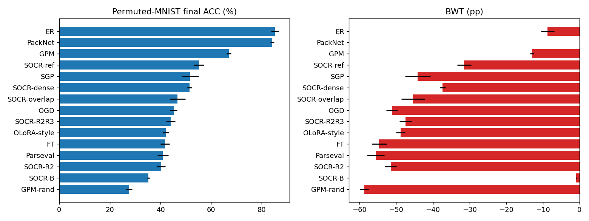
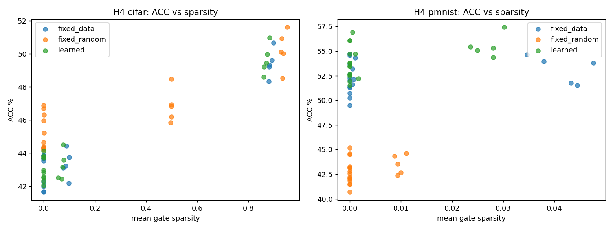
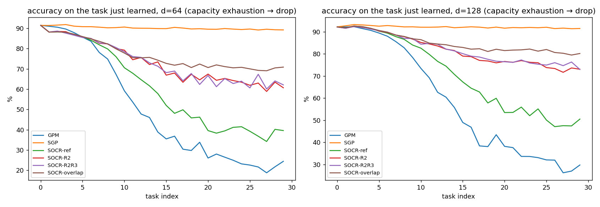

# SOCR: Sparse-Orthogonal Capacity Recycling for Continual Learning

A neural network that learns tasks one after another tends to forget the earlier ones (**catastrophic forgetting**). SOCR tries to prevent this by giving each new task its own protected region of weight space, and by reclaiming that space when the network runs out of room.

This repository contains the complete experiment suite for the SOCR proposal: a single notebook, the raw summary tables from the full run (685 runs, 5 seeds), and the figures.

## The idea in short

- **Learned orthogonal frames.** Each new task learns its update inside a subspace that is orthogonal to the inputs earlier tasks relied on, so updates cannot disturb old outputs. The frame itself is learned on the Stiefel manifold.
- **Sparse adapters.** Each task adds a low-rank adapter, `ΔW = S · diag(z) · Qᵀ`, whose components are switched on or off by an L0 (hard-concrete) gate. Sparse adapters use fewer protected dimensions, which should leave room for more tasks.
- **Subspace recycling.** When the free dimensions run out, protected directions are released in order of importance (**R2**), optionally followed by a short repair step (**R3**), or shared softly (**overlap**).
- **Theory.** Three non-interference results are checked numerically (see below).

Setting: task-incremental learning with per-task output heads, on Permuted-MNIST and Split CIFAR-100 (flattened inputs, MLP).

## Repository contents

| Path                         | What it is                                                                      |
| ---------------------------- | ------------------------------------------------------------------------------- |
| `SOCR_experiments.ipynb`     | Everything: data, SOCR learner, baselines, experiment runner, analysis, figures |
| `results/summary.json`       | Machine-readable summary of every test below                                    |
| `results/theory_checks.json` | Numerical checks of Theorems 1 to 3                                             |
| `results/table_*.csv`        | Result tables for each experiment (E1 to E5) and hypothesis (H1 to H4)          |
| `results/runs_summary.csv`   | One row per finished run                                                        |
| `results/figs/`              | Figures used below                                                              |

The raw per-task logs (about 30 MB) are not stored in the repository. Running the notebook regenerates them.

## Experiments

| ID     | What it tests                                                                                      |
| ------ | -------------------------------------------------------------------------------------------------- |
| E1     | Main comparison against FT, STL, ER, Parseval, OGD, PackNet, GPM, SGP and an O-LoRA-style baseline |
| E2     | Width sweep (64, 128, 256) and the capacity law `N_max ≈ d / r̄`                                    |
| E3     | One-factor-at-a-time ablation of SOCR components                                                   |
| E4     | Negative controls (random projector, fixed random rotation, shuffled assignment, random mask)      |
| E5     | Behaviour beyond capacity (N > N_max) with R2, R2+R3 and overlap recycling                         |
| E6, E7 | Footprint and sparsity sweeps; learned versus fixed frames                                         |
| E8     | Numerical checks of the three theorems                                                             |

## Results

### Main comparison (E1)

Final average accuracy (ACC, %) and backward transfer (BWT, percentage points, closer to 0 is less forgetting). Width 256, mean over 5 seeds.

| Method                       | CIFAR-100, 10 tasks: ACC / BWT | CIFAR-100, 20 tasks: ACC / BWT | Permuted-MNIST, 20 tasks: ACC / BWT |
| ---------------------------- | ------------------------------ | ------------------------------ | ----------------------------------- |
| Fine-tuning                  | 23.5 / −35.5                   | 33.7 / −36.8                   | 41.8 / −54.6                        |
| Experience replay            | 41.7 / −14.9                   | 58.6 / −10.4                   | 85.2 / −8.7                         |
| GPM                          | 51.4 / −0.5                    | 62.7 / −0.4                    | 67.0 / −12.9                        |
| SGP                          | 36.2 / −22.4                   | 49.5 / −20.8                   | 51.7 / −44.1                        |
| PackNet                      | 56.6 / 0.0                     | 69.0 / 0.0                     | 84.1 / 0.0                          |
| O-LoRA-style                 | 34.4 / −21.1                   | 53.6 / −13.4                   | 42.0 / −48.8                        |
| **SOCR (reference)**         | 43.4 / −5.7                    | 54.8 / −4.7                    | 55.1 / −31.5                        |
| **SOCR-B (reserve variant)** | 47.8 / −1.3                    | 59.3 / −1.1                    | 35.2 / −0.9                         |

What this shows:

- On **CIFAR-100**, the reserve variant (SOCR-B) reaches near-zero forgetting and lands within about four points of GPM at 20 tasks, roughly level with experience replay. PackNet is higher, but it uses a separate mask per task.
- On **Permuted-MNIST**, SOCR does **not** compete. SOCR (reference) forgets more than GPM, and SOCR-B avoids forgetting only by learning little: its plasticity ratio is 0.35, so it stops learning new tasks well after about three tasks.
- SOCR is better than the O-LoRA-style baseline in every column.

### Do the orthogonal frames matter? (E3 and E4)

Yes, and the controls show it is not just "freeze some capacity":

- Turning orthogonality off drops accuracy by about 6 points and pushes BWT from about −33 to about −62.
- A fixed random rotation, a random projector, a random mask and a shuffled task assignment are all clearly worse than the data-aligned frame (6 to 21 points of accuracy).
- Footprint-only, L0-only and no sparsity all perform about the same, so sparsity did not help accuracy in this setting.

See `results/table_E3_E4_ablation_controls.csv`.

### Pre-registered hypotheses

|     | Hypothesis                                                                                     | Outcome                                                                                                                                                                                                                                        |
| --- | ---------------------------------------------------------------------------------------------- | ---------------------------------------------------------------------------------------------------------------------------------------------------------------------------------------------------------------------------------------------- |
| H1  | Below capacity, forgetting is near zero and each update stays within the Theorem-2 drift bound | **Partly supported.** Drift was within the bound in every run, but forgetting is near zero only for the reserve variant and for GPM on CIFAR-100. SOCR (reference) forgets about 5 points on CIFAR-100 and about 29 on Permuted-MNIST          |
| H2  | Footprint regularisation shrinks the input footprint and raises N_max at equal accuracy        | **Not supported.** The strongest setting (λ_r = 0.5) raised N_max by about 10 tasks and cut the footprint, but cost about 13 points of accuracy on early tasks, so accuracy was not equal                                                      |
| H3  | Beyond capacity, the loss from releasing a dimension stays below the second-order bound        | **Inconclusive.** The bound held in all 1,265 recorded release events, but it is very loose (median measured-to-bound ratio about 0.01) and its correlation with the measured loss was weak                                                    |
| H4  | At equal sparsity, a learned frame beats a fixed frame                                         | **Not supported overall.** Learned frames beat fixed data-derived frames on Permuted-MNIST (+1.8 points, 95% CI 0.9 to 2.7) but not on CIFAR-100 (+0.1, CI −0.4 to 0.7), and a fixed random frame did better than the learned one on CIFAR-100 |

### Beyond capacity (E5)

Recycling restores the ability to learn new tasks once the free dimensions run out, but at a large cost in forgetting. At width 64, the R2 and R2+R3 variants reach only about 19 to 22% accuracy with BWT near −51 to −58, whereas GPM reaches about 42% with BWT near −8. The reserve variant, in contrast, keeps forgetting small and loses plasticity (new-task accuracy about 11% after the capacity limit).

### Capacity law (E2)

The predicted capacity `N_max ≈ d / r̄` did not match what was observed: predicted values were roughly 4 to 8 tasks, while observed capacity was often much larger (and censored at the 31-task limit for several methods and widths). See `results/table_E2_capacity.csv`.

### Theory checks (E8)

| Check                       | Result                                                                                       |
| --------------------------- | -------------------------------------------------------------------------------------------- |
| Theorem 1 (exact isolation) | Largest change in old-task outputs with projected updates: 8.7e−15. Without projection: 64.8 |
| Theorem 2 (drift bound)     | Held for all six truncation levels tested                                                    |
| Theorem 3                   | Identity residual 3.3e−16                                                                    |
| Gauge freedom               | Product of factors unchanged to 6.7e−16 under rotation                                       |

## Takeaways

1. The non-interference guarantees hold numerically, and the data-aligned orthogonal frame is what protects old tasks, not merely frozen capacity.
2. The reserve variant achieves near-zero forgetting, but at the price of plasticity. Its capacity ceiling is the main open problem.
3. The Stiefel-learned frame is not clearly worth its complexity: it helped on one benchmark and not the other.
4. Recycling extends capacity in principle, but in these experiments it forgot too much to be useful in practice.
